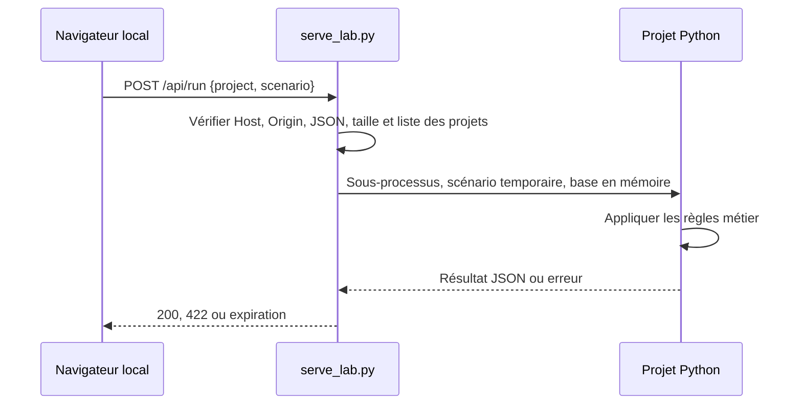

# Laboratoire local interactif

## Chemin d'une exécution



## Démarrage

Depuis la racine : `python3 automation/serve_lab.py --port 8080`. Le serveur écoute sur 127.0.0.1 uniquement. Les processus ne survivent pas nécessairement à une nouvelle session cloud ; la commande doit être relancée. Aucun service système n'est installé.

Les fichiers du catalogue restent statiques. Le code des moteurs n'est pas téléchargé par l'interface : le serveur lance une entrée Python fixée par la liste des 22 projets. Chaque requête dispose d'un fichier d'entrée temporaire et d'une base SQLite en mémoire ; modifier un scénario ne change ni le code ni les exemples de référence.

## Interface API

`POST /api/run`, Content-Type application/json :

```json
{"project":"taskboard","scenario":{"commands":[{"action":"create","id":"T1","title":"Exemple","actor":"alice"}]}}
```

Réussite : `{"result": ...}`. Erreur : `{"error": "..."}`.

| Code HTTP | Signification |
| --- | --- |
| 200 | Le scénario a été traité ; ses décisions métier peuvent inclure un refus ou un échec |
| 400 | Requête ou projet invalide |
| 403 | Host ou Origin refusé |
| 408 | Sous-processus arrêté après 10 secondes |
| 413 | Entrée vide, entrée supérieure à 512 000 octets ou résultat supérieur à 2 000 000 caractères |
| 415 | Content-Type différent de application/json |
| 422 | Scénario incompatible avec le contrat du moteur |
| 429 | Deux exécutions sont déjà en cours |

Pour PulseWatch, le serveur remplace les URL reçues par deux cibles locales : le catalogue et une réponse 503 volontaire. La sonde CLI reste utilisable sur des services autorisés en dehors de cette API.

## Portée des protections

Le laboratoire refuse les projets hors catalogue, n'utilise pas de shell pour l'exécution et ne transmet pas de chemin de base utilisateur. Les requêtes de navigateur venant d'une autre origine sont refusées. Les accès directs par des programmes locaux restent possibles.

**Ce n'est pas un bac à sable de production.** Le sous-processus possède les permissions du serveur local ; son entrée JSON ne permet pas de fournir du code Python, mais une consommation importante de ressources reste possible jusqu'à son expiration. La sortie est bornée après capture, pas pendant ; aucune limite mémoire système n'est appliquée. Pas d'authentification, TLS, limitation de débit persistante ou protection contre des utilisateurs locaux hostiles. Ne pas exposer ce serveur directement sur Internet ni changer son écoute sans une conception de déploiement adaptée.

## Validation

`python3 -m unittest discover -s automation -p 'test_*.py' -v` vérifie le transport HTTP local : exécution de chaque scénario, erreurs, refus d'origine et restriction de la sonde. Le catalogue JavaScript est également vérifié syntaxiquement ; aucun test automatisé dans un navigateur réel n'est encore livré.
